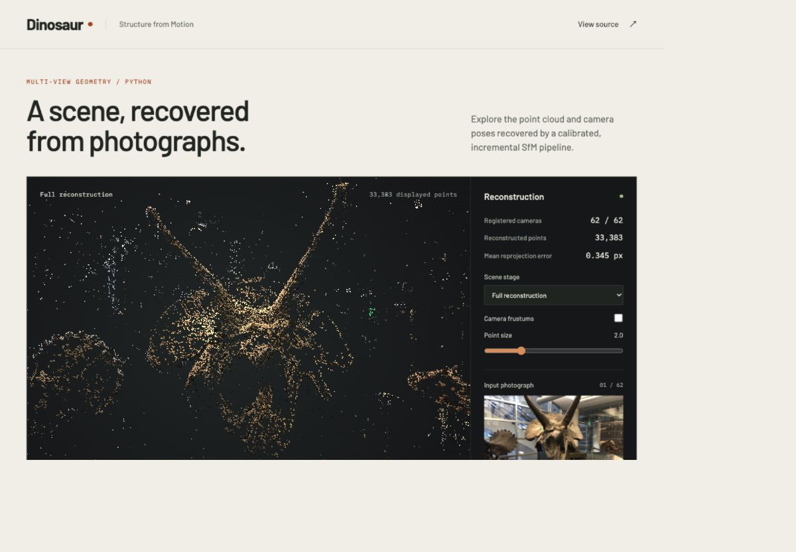

# Dinosaur · Incremental Structure from Motion

Reconstruct a dinosaur exhibit from 62 calibrated photographs using an incremental Python SfM pipeline. Inspect the recovered scene, camera poses and source images in a browser.



**[Open the interactive demo](https://7henghhhy.github.io/reconstrct-dino/)** · [Download the dataset](https://github.com/7henghhhy/reconstrct-dino/releases/tag/dinosaur-data-v1)

## Run the demo

```bash
python3 -m http.server 8000 --directory docs
```

Open [the local viewer](http://localhost:8000). Drag to orbit, shift-drag to pan and scroll to zoom. The controls switch between two-view initialization and the full reconstruction, display camera frustums, and select an input photograph. Keyboard controls include arrow keys, `+`, `-` and `Home`. A WebGL-capable browser is required.

The viewer loads measured results from `docs/assets/scene.json`. The full point cloud, camera poses and run metrics are downloadable from the page.

## Reproduce the reconstruction

Use Python 3.11. The pinned dependencies match the local validation environment.

```bash
git clone https://github.com/7henghhhy/reconstrct-dino.git
cd reconstrct-dino
python3.11 -m venv .venv
source .venv/bin/activate
python -m pip install -r requirements.txt
```

Download `dinosaur-data.zip` from the dataset release and extract it at the repository root. You can use GitHub CLI for this step.

```bash
gh release download dinosaur-data-v1 --pattern dinosaur-data.zip
python -m zipfile -e dinosaur-data.zip .
```

Expected inputs are `重建所需数据/images/` containing 62 JPEG images and `重建所需数据/camera_intrinsic.txt` containing a 3×3 calibration matrix. The dataset archive SHA-256 is `473e5ab60d04c98bff080ccfc3c076c11832aad12a10fd354d3809c9a004177e`.

```bash
OPENBLAS_NUM_THREADS=1 OMP_NUM_THREADS=1 python main.py --demo-dir docs/assets
```

The default configuration resizes images to 1600×1200 and scales the intrinsic matrix accordingly. It retains up to 6,000 SIFT features per image and matches a circular window of six neighboring views. `python main.py --help` lists input, output, sampling and optimization options.

### Generated files

| File under `outputs/`                       | Contents                                                                                   |
| ------------------------------------------- | ------------------------------------------------------------------------------------------ |
| `keypoints.jpg`, `matches.jpg`              | Feature and initialization-match visualizations                                            |
| `initial_points.ply`, `initialization.json` | Two-view seed cloud, image indices and world-to-camera poses                               |
| `pre_ba.npz`                                | Poses, points, colors, observation indices and scaled intrinsics before BA                 |
| `reconstruction.npz`                        | Optimized geometry, observations and final point-export mask                               |
| `final_points.ply`                          | RGB full-scene sparse point cloud                                                          |
| `final_poses.txt`                           | One flattened 4×4 world-to-camera matrix per input image                                   |
| `reconstruction.ply`, `reconstruction.txt`  | Submission-format copies with a configurable basename                                      |
| `metrics.json`                              | Configuration, image order, registration log, reprojection statistics and optimizer status |

For course-style filenames, pass `--student-id YOUR_ID`. Outputs are written to `outputs/YOUR_ID.ply` and `outputs/YOUR_ID.txt`.

The image `DJI_20200223_163225_243.jpg` defines the world coordinate system. Its pose is the identity matrix and occupies the first row. `metrics.json` records the remaining image order. The default dataset exports 62 rows of 16 values. Custom image sets use their first sorted image when the designated reference is absent.

An incomplete registration raises an error and records missing image names in `failure.json`. All successfully exported cameras have estimated poses. Run completion is recorded in `metrics.json`.

## Method

| Module           | Implementation                                                                                                           |
| ---------------- | ------------------------------------------------------------------------------------------------------------------------ |
| `feature.py`     | Calibrated image resizing and OpenCV SIFT feature extraction                                                             |
| `match.py`       | Bidirectional Lowe ratio test, one-to-one matching and fundamental-matrix RANSAC                                         |
| `initialize.py`  | Anchor-pair selection by valid triangulations, essential-matrix pose recovery, positive-depth and parallax checks        |
| `reconstruct.py` | Track bookkeeping, correspondence voting, PnP RANSAC with LM refinement, candidate retries and incremental triangulation |
| `ba.py`          | Joint sparse robust least squares using analytic projection derivatives and SciPy LSMR                                   |
| `main.py`        | Pipeline orchestration, color sampling, independent pair checks, exports and viewer asset generation                     |

Each feature belongs to at most one 3D point. Each point has at most one observation per image. New points require positive depth in both cameras, at least 1.5° triangulation angle and at most 2 px reprojection error. PnP uses a 3 px threshold. Exported points must satisfy a 4 px maximum error across their optimized observations.

BA minimizes a `soft_l1` reprojection objective with fixed intrinsics. It fixes the reference camera and one nonzero translation component of a second camera, removing the seven-degree-of-freedom similarity gauge. Its JSON status includes the solver termination message and evaluation count. Colors are median RGB samples across a point's observations.

## Results and ablations

| Configuration                  | Images | Points before export filtering | Mean error | Median error | Mean track length | Pair agreement | BA status            |
| ------------------------------ | ------ | ------------------------------ | ---------- | ------------ | ----------------- | -------------- | -------------------- |
| PnP, before BA                 | 62     | 33,385                         | 0.648 px   | 0.446 px     | 5.00              | —              | Disabled             |
| PnP + BA                       | 62     | 33,385                         | 0.345 px   | 0.263 px     | 5.00              | 99.9%          | ftol reached         |
| PnP + BA, half images          | 31     | 22,107                         | 0.327 px   | 0.259 px     | 3.34              | 98.6%          | Budget reached (300) |
| Essential-only, unit baselines | 62     | 64,629                         | 0.311 px   | 0.165 px     | 2.08              | 61.0%          | Disabled             |

The full run exports **33,383 points** after filtering and registers **62/62 cameras**. BA reaches the relative-cost termination condition after 80 evaluations. The 31-image ablation reaches its explicit 300-evaluation budget, and its optimization remains incomplete. All errors are in pixels at 1600×1200 resolution.

Reprojection statistics use the full track set before final point filtering. The before/after BA comparison uses exactly the same observations. The essential-only and reduced-image runs construct their own track sets, so their reprojection errors depend on different observations. Mean track length and agreement over all verified image-pair matches provide additional context.

Pair agreement is the fraction of every verified pair match whose triangulation has positive depth in both recovered cameras and at most 2 px reprojection error in each view. This check uses the same verified matches for the two 62-image pose methods. It evaluates compatibility between matched views and recovered poses.

```bash
# Remove global BA.
python main.py --no-ba --output outputs/no_ba

# Retain every second image. A larger explicit BA budget is used for this ablation.
python main.py --stride 2 --ba-evaluations 300 --output outputs/stride2

# Replace PnP with chained essential-matrix poses, each with a unit baseline.
python main.py --pose-method essential --no-ba --output outputs/essential
```

`docs/assets/ablations.json` and the accompanying metrics files contain the measured ablation summaries.

### Limits

Monocular scale is arbitrary. Ground-truth geometry and poses were unavailable, so metric accuracy and absolute trajectory error remain unmeasured. Low two-view reprojection errors can coexist with inconsistent scales between image pairs. The essential-only ablation explicitly assigns each new baseline unit length.

The dataset has limited surface coverage. The result is a sparse point cloud. Calibration is held fixed and lens distortion is assumed negligible. Circular neighbor matching reflects this capture sequence. Large viewpoint gaps and repeated structures can break registration. The default BA budget is 100 function evaluations, and each run records whether a convergence condition was reached.

## Verification

```bash
python -m py_compile feature.py match.py initialize.py reconstruct.py ba.py main.py
python -m unittest discover -s tests -v
node --check docs/viewer.js
```

The geometry regressions cover triangulation and pose direction, robust PnP refinement, BA gauge fixing, and retrying a failed registration candidate. GitHub Actions runs these checks on Python 3.11.

The Pages workflow publishes `docs/` when manually dispatched after Pages is enabled for this repository.

## Context

This project rebuilds a computer-vision coursework reconstruction pipeline as a reproducible portfolio project. OpenCV supplies feature extraction and geometric estimation primitives. The project implements incremental registration, track management, triangulation filtering, sparse optimization assembly, evaluation and visualization.
